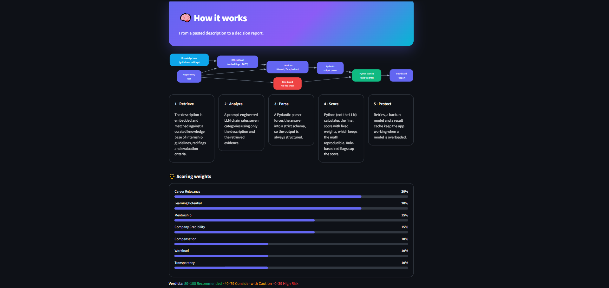
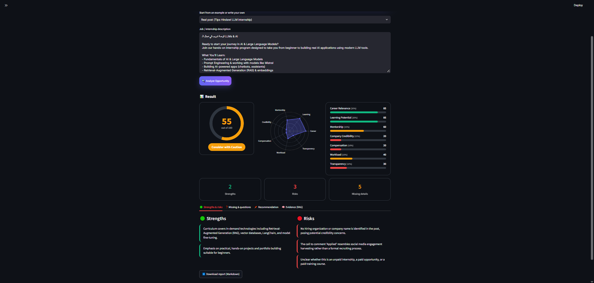
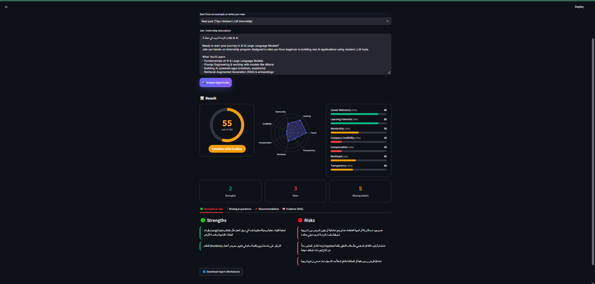
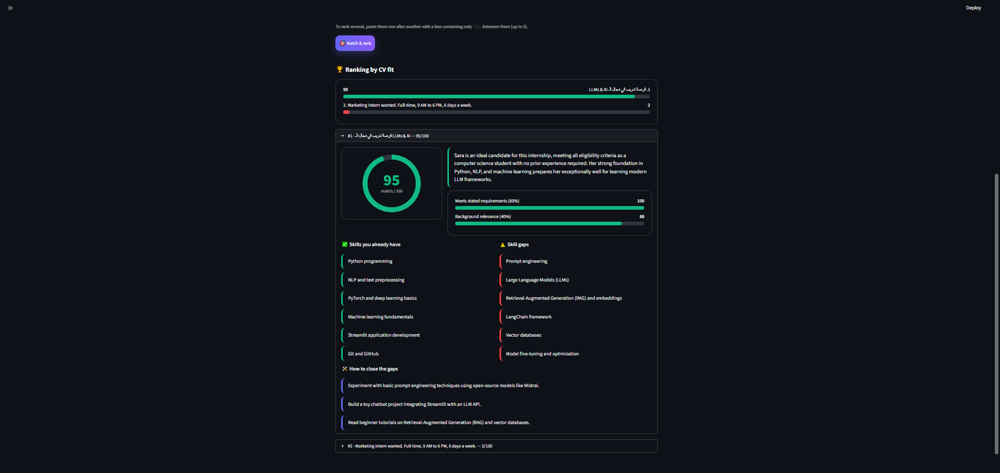
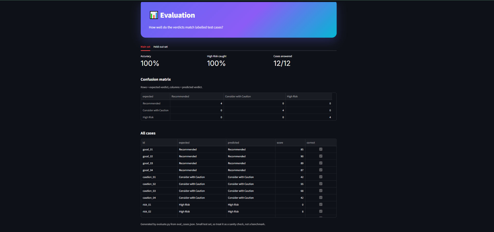

# OpportunityLens AI

AI-powered analyzer for internship and job descriptions. Paste an opportunity and get a score,
a verdict, strengths, risks, missing information and questions to ask before applying.
Upload your CV to see how well you fit and to rank several opportunities.

## Features
- **Opportunity analysis**: 7-category score (0 to 100) with verdict Recommended / Consider with Caution / High Risk.
- **RAG**: the description is matched against a knowledge base of internship guidelines and red flags
  (sentence-transformer embeddings + FAISS), and the retrieved passages are shown as evidence.
- **Deterministic scoring**: the LLM only rates each category; Python computes the final score with fixed weights.
- **Rule-based red flags**: fee requests, ID/bank details, cheque schemes and "guaranteed job" claims cap the score.
- **CV match and ranking**: upload a PDF, DOCX or TXT CV and rank up to 5 opportunities by fit
  (60% stated requirements, 40% background relevance).
- **English / Arabic reports**.
- **Reliability**: result cache, Gemini with Groq as backup, strict Pydantic output parsing.
- **Evaluation page**: labelled test cases with accuracy and a confusion matrix.

## Architecture
Opportunity text -> RAG retrieval (FAISS) -> LLM chain (Gemini, Groq backup) -> Pydantic parser
-> Python scoring + red-flag rules -> Streamlit dashboard and report.



## Screenshots





## Evaluation
| Set | Cases | Accuracy | High Risk caught |
|---|---|---|---|
| Main (used to calibrate the verdict thresholds) | 12 | [__]% ([__]/12) | [__]% |
| Held-out (written after the thresholds were fixed) | 8 | [__]% ([__]/8) | [__]% |

Notes:
- The first run with thresholds 90/70 scored 58% (7/12): borderline cases were labelled High Risk.
  I recalibrated the thresholds to 80/40, then tested on 8 new cases not used for tuning.
- Both sets are small, so treat the numbers as a sanity check, not a benchmark.
- Results come from a mix of Gemini and Groq models, because the Gemini quota ran out during runs.

## Setup
```
python -m venv .venv
.venv\Scripts\activate
pip install -r requirements.txt
```
Copy `.env.example` to `.env` and add your `GEMINI_API_KEY` and `GROQ_API_KEY`.

Run the app:
```
python -m streamlit run app.py
```

Run the evaluation:
```
python evaluate.py --fresh
python evaluate.py --cases eval_holdout.json --out eval_holdout_results.json --fresh
```

## Project structure
```
app.py                  Streamlit UI
evaluate.py             runs labelled test cases
eval_cases.json         main test set (12)
eval_holdout.json       held-out test set (8)
data/knowledge_base/    guidelines and red-flag documents
src/rag.py              load, split, embed, FAISS retriever
src/chains.py           analysis prompt and chain
src/llm_calls.py        cache, Gemini, Groq fallback
src/schemas.py          Pydantic models
src/scoring.py          weights, verdicts, red-flag cap
src/redflags.py         rule-based red-flag detection
src/pipeline.py         analyze_opportunity_with_context()
src/cv_match.py         CV vs opportunity comparison
src/cv_reader.py        text extraction from PDF/DOCX/TXT
src/cv_page.py          CV Match page
```

## Limitations
- The knowledge base is small and hand-written.
- The app reads only the text you paste; it cannot verify that a company is real.
- The embedding model is English-only, so Arabic job descriptions retrieve less well.
- The red-flag rules match English text only.
- CV ranking measures skill fit, not the quality or safety of an opportunity.
- Scanned PDFs have no text layer; paste the CV text instead.
- AI output can be wrong. This is decision support, not a guarantee.